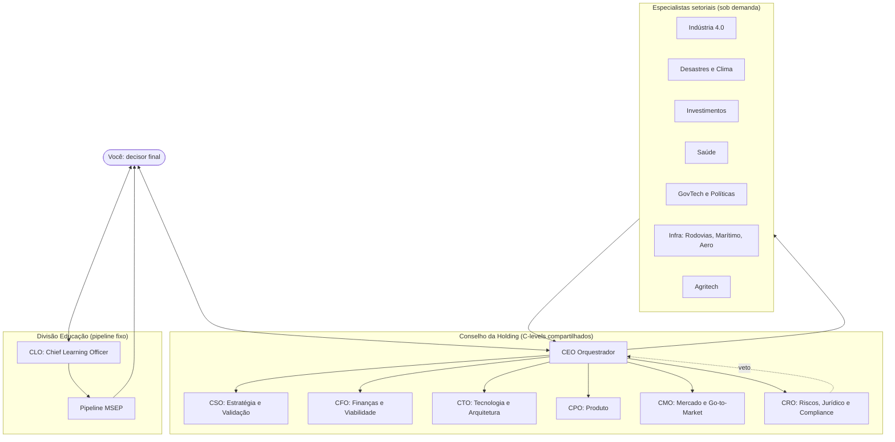
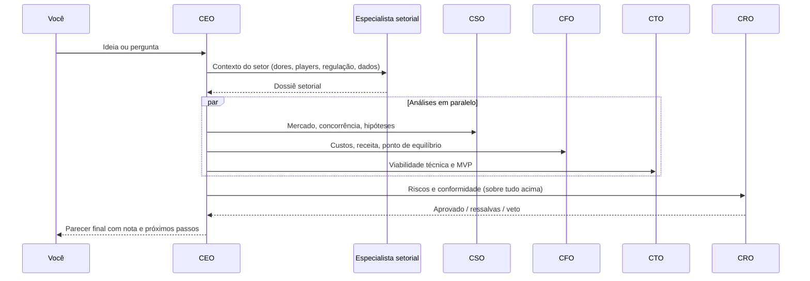
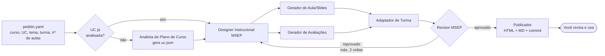
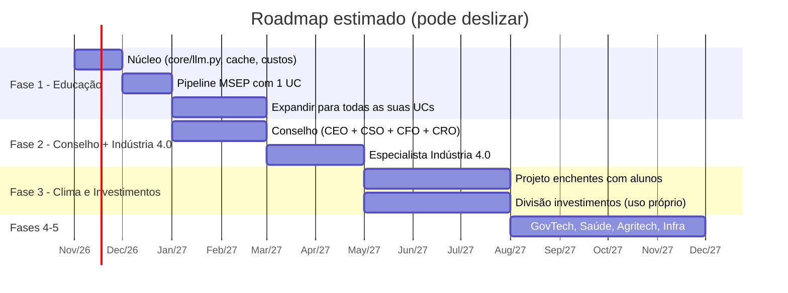

# Conglomerado de Agentes de IA: Conselho C-Level e Especialistas Setoriais

> Documento de arquitetura e papéis. Versão 1.0, outubro de 2026.
> Escrito para ser versionado no GitHub. Os diagramas usam Mermaid, que o GitHub renderiza nativamente.

**Legenda de confiança:** **[Certeza]** = fato verificável · **[Provável]** = dedução forte · **[Chute]** = estimativa para preencher lacuna (valide antes de usar).

---

## 0. Leia isto primeiro: as verdades desconfortáveis

1. **Você não vai construir 14 negócios. Vai construir um sistema que avalia ideias de negócio em 14 setores.** [Provável] Com 5 a 15 horas por semana e R$ 200 por mês, operar empresas está fora de alcance. Gerar, comparar e matar ideias rapidamente está ao alcance, e é isso que este documento desenha.
2. **O primeiro retorno não vem dos negócios. Vem das suas aulas.** [Provável] A Fase 1 (Educação/SENAI) é a única que resolve uma dor real e diária, usa um domínio que você já domina e gera material para testar a arquitetura. Se ela não funcionar, o resto não vai funcionar.
3. **O orçamento manda na arquitetura.** [Provável] R$ 200 por mês (cerca de US$ 35 a 40) exclui modelos de ponta em tudo, exclui orquestradores tagarelas e exclui modelos locais pesados, porque você não tem GPU forte. A regra do documento é: **modelo barato por padrão, modelo caro só no ponto de decisão.**
4. **Investimentos para terceiros exigem registro na CVM.** [Provável] Recomendar ativos ao público é atividade regulada pelas resoluções CVM 19 (consultor) e CVM 20 (analista). O agente de compliance não é enfeite: ele bloqueia a publicação de qualquer recomendação para terceiros enquanto você não tiver o credenciamento ou um parceiro credenciado.
5. **Alerta de enchente envolve vidas.** [Provável] O sistema apoia a Defesa Civil; nunca a substitui como fonte oficial de alerta para a população.
6. **Day trade fica fora das primeiras fases.** [Provável] Agentes que "só recomendam" e esperam sua aprovação são lentos demais para operações intradiárias.

---

## 1. Premissas (do refinamento)

| Item | Decisão |
|---|---|
| Objetivo | Idear e validar negócios (não operar) |
| Autonomia | Agentes **só recomendam**; toda decisão é humana |
| Estrutura | **Holding** com conselho C-level único + especialistas por setor |
| Interface | **CEO orquestrador** para ideação e análise; **pipelines fixos** para tarefas repetitivas (aulas) |
| Stack | Python próprio (você domina Python e Django) |
| Orçamento | Até R$ 200/mês em APIs e infraestrutura |
| Hardware | Sem GPU forte → nada de modelos locais grandes |
| Tempo | 5 a 15 h/semana |
| Fase 1 | Educação/SENAI: TI, Gestão/Logística, Eletro/Mecatrônica, com **MSEP rigorosa** |
| Fase 2 | Indústria 4.0: robótica, mecatrônica, têxtil, metalúrgica (acesso via alunos e empresas parceiras do SENAI) |
| Saída das aulas | HTML/web + Markdown no GitHub |
| Enchentes | GovTech + apoio à Defesa Civil + alerta + projeto educacional, **só dados públicos** |
| Investimentos | Para você e para terceiros; swing, longo prazo e macro (day trade adiado) |

---

## 2. Arquitetura geral

**Princípio central:** C-levels são organizados por **função**, não por setor. O CFO avalia finanças de uma ideia têxtil do mesmo jeito que de uma ideia agritech. O que muda é o **especialista setorial** que entrega o contexto. Isso evita mais de 100 agentes duplicados.



### 2.1 Dois modos de operação

| Modo | Quando usar | Quem conduz | Custo |
|---|---|---|---|
| **Pipeline fixo** | Tarefa repetitiva com passos conhecidos (aula, relatório semanal de enchentes, resumo de mercado) | Código Python, sem orquestrador | Baixo e previsível |
| **Conselho orquestrado** | Pergunta aberta ("vale a pena um negócio de sensores de nível de rio?") | CEO orquestrador | Mais alto; limitar por rodada |

[Provável] Na prática, 80% do uso deve ser pipeline e 20% conselho. Se inverter, o orçamento estoura.

### 2.2 O fluxo de validação de uma ideia (modo conselho)



---

## 3. O Conselho da Holding (7 C-levels)

Cada papel segue o mesmo formato: missão, entradas, saídas, ferramentas, KPIs, limites e prompt-base. Os prompts-base são pontos de partida: ajuste com uso real.

### 3.1 CEO — Orquestrador

- **Missão:** receber suas perguntas, decidir quais agentes acionar, consolidar os pareceres e entregar uma recomendação única e acionável.
- **Entradas:** sua pergunta; histórico de decisões (`decisions/`); dossiês setoriais.
- **Saídas:** parecer final em Markdown com: recomendação (seguir / pivotar / matar), nota de 0 a 10, divergências entre os C-levels, próximos 3 passos.
- **Ferramentas:** chamadas aos demais agentes; leitura do repositório de decisões.
- **KPIs:** % de pareceres que você considera úteis; custo médio por parecer; tempo até a resposta.
- **Limites:** não inventa dados; não esconde divergências entre C-levels; não chama mais de 4 agentes por rodada sem justificar; obedece ao veto do CRO.
- **Modelo:** barato para roteamento; intermediário para a síntese final.

```text
Você é o CEO orquestrador de um conselho consultivo de agentes de IA.
Seu dono é um profissional de TI (15 anos), programador Python/Django e professor do SENAI.
Os agentes apenas RECOMENDAM; a decisão final é sempre dele.

Para cada pergunta:
1. Classifique: setor(es), tipo (ideia nova, validação, comparação, pergunta factual).
2. Escolha no máximo 4 agentes necessários e justifique em 1 linha cada.
3. Consolide os pareceres sem suavizar divergências.
4. Respeite qualquer veto do CRO.
5. Entregue: recomendação (seguir/pivotar/matar), nota 0-10, riscos principais,
   divergências, 3 próximos passos concretos e baratos.
Marque cada afirmação como [Certeza], [Provável] ou [Chute].
Comece pela conclusão mais desconfortável.
```

### 3.2 CSO — Estratégia e Validação

- **Missão:** testar se a ideia resolve um problema real, para quem, e contra quem compete.
- **Entradas:** dossiê setorial; descrição da ideia.
- **Saídas:** mapa de hipóteses (problema, cliente, solução, canal) com o teste mais barato para cada; concorrentes; tamanho de mercado estimado com fonte.
- **Ferramentas:** busca web; base de conhecimento setorial.
- **KPIs:** hipóteses testadas por mês; % de ideias mortas cedo (matar cedo é sucesso).
- **Limites:** toda estimativa de mercado precisa de fonte ou ser marcada como [Chute].

```text
Você é o CSO. Seu trabalho é tentar MATAR a ideia antes que ela consuma tempo.
Liste as 3 hipóteses mais arriscadas, o teste mais barato (em reais e horas) para cada,
e quem são os concorrentes diretos e indiretos no Brasil.
Priorize testes que o dono possa fazer via rede do SENAI (alunos, empresas parceiras).
```

### 3.3 CFO — Finanças e Viabilidade

- **Missão:** dizer quanto custa, quanto pode render e em quanto tempo.
- **Saídas:** custo de MVP, custo mensal, modelo de receita, ponto de equilíbrio, cenário pessimista/base/otimista.
- **Extra:** controla o **orçamento de IA do próprio sistema** (lê o log de custos de tokens e alerta ao passar de 80% dos R$ 200).
- **KPIs:** desvio entre custo previsto e real; alertas de orçamento emitidos a tempo.
- **Limites:** sempre mostra premissas; nunca apresenta projeção sem cenário pessimista.

```text
Você é o CFO. Para cada ideia, entregue uma tabela com 3 cenários (pessimista, base, otimista):
investimento inicial, custo mensal, receita mensal, meses até o ponto de equilíbrio.
Liste cada premissa e marque sua confiança. Valores em R$.
Considere que o fundador tem 5-15 h/semana e capital limitado.
```

### 3.4 CTO — Tecnologia e Arquitetura

- **Missão:** dizer se dá para construir com a stack do dono (Python, Django, JS, HTML/CSS) e como seria o MVP mínimo.
- **Saídas:** arquitetura do MVP, componentes, estimativa em horas, riscos técnicos, o que comprar pronto versus construir.
- **KPIs:** precisão da estimativa de horas.
- **Limites:** prefere a stack que o dono já domina; justifica qualquer tecnologia nova.

```text
Você é o CTO. O fundador domina PHP, Python, Django, JavaScript, HTML e CSS.
Proponha o MVP mais simples possível nessa stack, estimado em horas.
Separe: o que construir, o que comprar/usar pronto, e o maior risco técnico.
Para hardware/IoT (robótica, sensores), considere ESP32/Arduino e Raspberry Pi,
que os alunos do SENAI de eletro/mecatrônica conhecem.
```

### 3.5 CPO — Produto

- **Missão:** transformar a ideia validada em um produto que alguém usa: usuário, jornada, funcionalidades do MVP, o que fica de fora.
- **Saídas:** persona, jornada, lista MoSCoW (Must/Should/Could/Won't), critérios de sucesso.
- **KPIs:** tamanho do MVP (quanto menor, melhor).

```text
Você é o CPO. Defina UMA persona principal, a jornada dela e no máximo 5 funcionalidades
"Must" para o MVP. Tudo o mais vai para "Won't (por enquanto)".
```

### 3.6 CMO — Mercado e Go-to-Market

- **Missão:** como chegar aos primeiros 10 clientes.
- **Saídas:** canal principal, mensagem, preço inicial, plano dos primeiros 30 dias.
- **Vantagem a explorar:** [Provável] sua rede do SENAI (empresas parceiras, alunos e egressos) é o canal mais barato que você tem para indústria e educação.

```text
Você é o CMO. Proponha como conseguir os primeiros 10 clientes pagantes em 90 dias,
com orçamento de marketing próximo de zero. Use a rede do SENAI (empresas parceiras,
alunos, egressos) como canal prioritário quando o setor permitir.
```

### 3.7 CRO — Riscos, Jurídico e Compliance (com poder de veto)

- **Missão:** encontrar o que pode dar errado de forma grave: regulação, dados pessoais, responsabilidade civil, segurança.
- **Checklists obrigatórios por tema:**
  - **Dados pessoais:** LGPD (base legal, dados sensíveis, especialmente saúde e menores de idade).
  - **Investimentos:** resoluções CVM 19/20 para recomendações a terceiros [Provável]; isenção clara para uso próprio.
  - **Saúde:** regulação da Anvisa para software como dispositivo médico, quando o produto influencia diagnóstico ou tratamento [Provável].
  - **Alertas de desastre:** o sistema nunca se apresenta como fonte oficial; sempre direciona à Defesa Civil.
  - **Educação:** direitos autorais de material didático; dados de alunos (muitos são menores na aprendizagem).
- **Saídas:** semáforo (verde / amarelo / vermelho) por risco; **veto** em vermelho.
- **Limites:** não é advogado; recomenda consultar profissional em todo vermelho.

```text
Você é o CRO, com poder de VETO. Avalie a ideia contra: LGPD, CVM (se envolver
recomendação de investimentos a terceiros), Anvisa (se envolver saúde), responsabilidade
civil (se envolver alertas ou segurança física), dados de menores de idade.
Para cada risco: semáforo, explicação em 1 linha, mitigação.
Se houver vermelho sem mitigação viável, emita VETO e explique o motivo.
Você não é advogado: recomende consulta profissional em todo item vermelho.
```

---

## 4. Divisão Educação — o C-level do seu dia a dia

### 4.1 CLO — Chief Learning Officer (Diretor de Educação)

Este é o C-level que você pediu para a sua área. Ele **não** passa pelo CEO: tem pipeline próprio, porque gerar aula é tarefa repetitiva com passos conhecidos.

- **Missão:** produzir material didático completo e em conformidade com a MSEP, a partir do plano de curso, com o mínimo de comandos seus.
- **Seu comando ideal:** um arquivo de pedido (veja 4.3) e **um** comando no terminal.
- **KPIs:**
  - Tempo seu por aula (meta: de horas para menos de 20 minutos de revisão) [Chute na meta].
  - % de materiais aprovados pelo Revisor MSEP na primeira passada.
  - Custo por aula em R$.
  - Número de comandos repetidos por você (meta: 1).

### 4.2 Os agentes sob o CLO

| Agente | Função | Modelo sugerido |
|---|---|---|
| **Analista de Plano de Curso** | Lê o plano de curso/UC e extrai capacidades técnicas, socioemocionais, conhecimentos e critérios de avaliação para um JSON estruturado | Barato (feito 1x por UC, depois reaproveitado) |
| **Designer Instrucional MSEP** | Gera o plano de ensino e as situações de aprendizagem (estudo de caso, desafio, projeto ou pesquisa aplicada) ligadas às capacidades | Intermediário |
| **Gerador de Aula/Slides HTML** | Produz a aula em Markdown e HTML (slides web, ex.: Reveal.js) | Barato |
| **Gerador de Avaliações** | Exercícios, instrumentos de avaliação e rubricas com critérios críticos e desejáveis | Barato |
| **Adaptador de Turma** | Ajusta linguagem, profundidade e exemplos para aprendizagem, técnico e qualificação | Barato |
| **Revisor MSEP (portão de qualidade)** | Confere tudo contra o JSON da UC: toda capacidade coberta? todo critério avaliado? Reprova com motivo | Intermediário (é o ponto de decisão) |
| **Publicador** | Gera os arquivos finais e o commit no GitHub | Sem LLM (código puro) |
| **Chief of Staff (opcional)** | Seu assistente pessoal: organiza o calendário de aulas, lembra prazos de diário e notas, resume e-mails da coordenação | Barato |

### 4.3 O pipeline fixo de uma aula



**Exemplo de `pedido.yaml`:**

```yaml
curso: Técnico em Desenvolvimento de Sistemas
unidade_curricular: Programação Back-End
tema: Introdução a APIs REST com Django
modalidade: tecnico          # aprendizagem | tecnico | qualificacao
turmas: [noturno-2026-2]
numero_aulas: 3
duracao_aula_min: 200
situacao_aprendizagem: desafio   # estudo_de_caso | desafio | projeto | pesquisa_aplicada
saidas: [html, markdown]
```

**Regras do pipeline:**

1. O `uc.json` de cada unidade curricular é gerado **uma vez** e reaproveitado em todas as aulas. [Provável] Isso sozinho elimina boa parte dos comandos que você repete hoje.
2. O Revisor MSEP tem no máximo 2 voltas de correção; se reprovar a terceira, o pipeline para e mostra o motivo para você.
3. Toda saída tem front matter com rastreabilidade (curso, UC, capacidades cobertas, data, custo).
4. **Você sempre revisa antes de usar em sala.** O revisor reduz erros; não elimina.

### 4.4 Estrutura de saída no GitHub

```text
aulas/
  tecnico-desenvolvimento-sistemas/
    programacao-back-end/
      uc.json
      plano-de-ensino.md
      aula-01-apis-rest/
        aula.md
        slides.html
        avaliacao.md
        rubrica.md
        revisao-msep.md      # parecer do revisor
```

---

## 5. Especialistas setoriais

Especialistas **não decidem**: produzem um **dossiê setorial** que alimenta o conselho. Cada um tem uma base de conhecimento própria (`knowledge/<setor>/`) que você enriquece com o tempo.

**Formato padrão do dossiê:** dores do setor; players e concorrentes; regulação aplicável; fontes de dados públicas; onde a IA já é usada; 3 oportunidades de nicho para um fundador com o seu perfil.

| Especialista | Setores cobertos | Ângulo para o seu perfil | Fase |
|---|---|---|---|
| **Indústria 4.0** | Robótica, mecatrônica, têxtil, metalúrgica | Visão computacional para inspeção de qualidade; manutenção preditiva com sensores baratos; acesso via empresas parceiras do SENAI | **2** |
| **Desastres e Clima** | Enchentes, El Niño, defesa civil | Painel de risco com dados públicos; projeto aplicado com alunos de eletro (sensores) e TI (painel) | 3 |
| **Investimentos** | B3, NYSE, Bolsa de Tóquio | Análise para uso próprio primeiro; produto para terceiros só após compliance | 3 |
| **GovTech e Políticas** | GovTech, políticas públicas e privadas | Ferramentas para prefeituras (risco, atendimento, transparência) | 4 |
| **Saúde** | Saúde | Alto risco regulatório; começar por áreas administrativas (agendamento, triagem administrativa), não clínicas | 4 |
| **Infraestrutura** | Rodovias, marítimo, aeroespacial | Rodovias: inspeção de pavimento por imagem; marítimo/aero: [Provável] barreira de entrada alta para um fundador solo | 5 |
| **Agritech** | Agricultura | Monitoramento de clima e solo, integrável com o especialista de Clima | 4 |
| **Educação** | Educação (como negócio) | Seu pipeline de aulas pode virar produto para outros professores | 2–3 |

```text
# Prompt-base comum aos especialistas (troque {SETOR})
Você é o especialista em {SETOR} de um conselho consultivo de agentes de IA.
Produza um dossiê setorial com: dores principais, players no Brasil e no mundo,
regulação aplicável, fontes de dados públicas, usos atuais de IA e 3 oportunidades
de nicho viáveis para um fundador solo com perfil de TI/Python/Django e professor do SENAI,
com 5-15 h/semana e pouco capital. Cite fontes ou marque como [Chute].
```

### 5.1 Desastres e Clima — detalhes

- **Fontes públicas a investigar** [Provável]: Cemaden (alertas e pluviômetros), ANA (níveis de rios via HidroWeb/SNIRH), INMET (meteorologia), Defesa Civil estadual e, em Santa Catarina, a Epagri/Ciram. Valide disponibilidade e termos de uso de cada API antes de construir.
- **Os 4 papéis que você escolheu viram 4 produtos diferentes**, e o conselho deve avaliá-los separadamente:

| Papel | Risco | Recomendação |
|---|---|---|
| Projeto educacional (SENAI) | Baixo | **Comece aqui.** Sensores com alunos de eletro + painel com alunos de TI |
| Apoio à Defesa Civil | Médio | Segundo passo, com o projeto educacional como prova de conceito |
| Produto GovTech | Médio | Depende de relação com prefeituras e de licitação |
| Alerta à população | **Alto** | Só reencaminhando alertas oficiais; nunca alerta próprio sem parceria formal |

### 5.2 Investimentos — detalhes

- **Agentes da divisão** (todos só recomendam):
  - **Analista Macro:** juros, câmbio, inflação (Brasil, EUA, Japão).
  - **Analista Fundamentalista:** balanços e indicadores (fonte brasileira: dados abertos da CVM [Provável]).
  - **Analista de Swing:** sinais técnicos em janelas de dias a semanas.
  - **Gestor de Risco:** tamanho de posição, limite de perda, correlação.
  - **Compliance CVM:** bloqueia qualquer saída destinada a terceiros sem a licença adequada.
- **Ordem:** backtest → uso próprio com valores pequenos → (com credenciamento ou parceria) produto para terceiros.
- **Day trade:** fora até a Fase 5, e só se a autonomia dos agentes for revista.
- [Certeza] Isto não é recomendação de investimento; o sistema é ferramenta de estudo e apoio à sua decisão.

---

## 6. Stack técnica e custos

### 6.1 Stack recomendada

| Camada | Escolha | Por quê |
|---|---|---|
| Linguagem | Python 3.12+ | Você domina |
| Orquestração | **Python puro + Pydantic** no início; LangGraph só se o fluxo ficar complexo | [Provável] Frameworks pesados escondem custo e dificultam depuração |
| Cliente de LLM | Camada própria (`core/llm.py`) com troca fácil de provedor | Permite usar o modelo mais barato que der conta de cada tarefa |
| Saídas estruturadas | Pydantic + JSON schema | Evita respostas soltas que quebram o pipeline |
| Cache | Cache em disco (SQLite) por hash do prompt + cache de prompt do provedor | Corta custo de reexecução |
| Interface | CLI no início; painel Django depois | Você já domina Django |
| Slides HTML | Reveal.js | Gratuito, em HTML, versionável |
| Versionamento | GitHub | Já previsto |
| Agendamento | GitHub Actions ou cron em VPS barata | Para pipelines periódicos (resumo de mercado, clima) |

### 6.2 Estratégia de modelos dentro de R$ 200/mês

| Tarefa | Classe de modelo |
|---|---|
| Roteamento, formatação, adaptação de turma, geração de slides | Modelo **pequeno e barato** |
| Plano de ensino, situações de aprendizagem, síntese do CEO | Modelo **intermediário** |
| Revisor MSEP, CRO, decisões de veto | Modelo intermediário; modelo de ponta só em casos ambíguos |

**Táticas de economia:**

1. **Cache de prompt** para o conteúdo fixo (MSEP, `uc.json`, instruções dos agentes). [Provável] Os grandes provedores dão desconto grande em tokens de entrada repetidos.
2. **API em lote (batch)** para tarefas que não têm pressa, como gerar todas as aulas da semana à noite. [Provável] Os grandes provedores oferecem cerca de 50% de desconto nesse modo.
3. **Log de custo por chamada** desde o primeiro dia (`logs/custos.csv`), lido pelo CFO.
4. **Teto rígido:** o cliente de LLM recusa novas chamadas ao atingir o orçamento do mês.

**Estimativa de custo** [Chute — refaça com os preços atuais do provedor escolhido]:

| Item | Estimativa |
|---|---|
| Uma aula completa (plano + slides + avaliação + revisão) | R$ 0,50 a R$ 2,00 |
| 60 aulas por mês | R$ 30 a R$ 120 |
| Um parecer do conselho (ideia de negócio) | R$ 1 a R$ 5 |
| 15 pareceres por mês | R$ 15 a R$ 75 |
| VPS opcional | R$ 25 a R$ 50 |

[Provável] Cabe nos R$ 200 **se** o conselho for usado com moderação. O pipeline de aulas é o item mais previsível; o conselho orquestrado é o que estoura.

---

## 7. Estrutura sugerida do repositório

```text
conglomerado-ia/
├── README.md
├── docs/
│   └── conglomerado-agentes-ia.md     # este documento
├── core/
│   ├── llm.py               # cliente único: provedor, cache, teto de custo, log
│   ├── schemas.py           # modelos Pydantic (UC, aula, parecer, dossiê)
│   └── config.py            # modelos por tarefa, orçamento mensal
├── agents/
│   ├── conselho/            # ceo.md, cso.md, cfo.md, cto.md, cpo.md, cmo.md, cro.md
│   ├── educacao/            # clo.md, analista_uc.md, designer_msep.md, ...
│   └── especialistas/       # industria40.md, clima.md, investimentos.md, ...
├── pipelines/
│   ├── aula_msep.py         # pipeline fixo da Seção 4.3
│   └── conselho.py          # fluxo de validação de ideias da Seção 2.2
├── knowledge/
│   ├── msep/                # resumo da metodologia, modelos de documento
│   ├── planos_de_curso/     # PDFs/textos dos planos (não versionar se forem restritos)
│   └── setores/             # dossiês salvos
├── pedidos/                 # pedido.yaml das aulas
├── aulas/                   # saídas (Seção 4.4)
├── decisions/               # pareceres do conselho, um arquivo por ideia
├── evals/                   # casos de teste dos agentes
└── logs/
    └── custos.csv
```

[Provável] Confira se os planos de curso do SENAI podem ficar em repositório público. Se houver dúvida, mantenha o repositório privado ou deixe `knowledge/planos_de_curso/` fora do Git.

---

## 8. Roadmap (com 5 a 15 h/semana)



| Fase | Entregável | Critério para avançar |
|---|---|---|
| **1** | Pipeline de aulas MSEP funcionando para todas as suas UCs | Você usa em sala por 1 mês e gasta menos de 20 min de revisão por aula [Chute na meta] |
| **2** | Conselho com CEO, CSO, CFO e CRO + especialista Indústria 4.0; depois CTO, CPO e CMO | 5 ideias avaliadas; ao menos 1 testada com uma empresa parceira |
| **3** | Projeto de enchentes com alunos; divisão de investimentos em backtest e uso próprio | Projeto apresentado; backtest documentado |
| **4–5** | Demais setores, sob demanda | Só entra setor novo quando houver uma ideia concreta para avaliar |

**Regra de ouro:** nenhuma fase começa antes de a anterior estar em uso real.

---

## 9. KPIs globais do sistema

| KPI | Meta inicial |
|---|---|
| Custo mensal total | ≤ R$ 200 |
| Horas suas por semana em tarefas repetitivas de aula | Cair pela metade na Fase 1 [Chute] |
| Ideias avaliadas por mês (Fase 2+) | 4 a 8 |
| % de ideias mortas na primeira rodada | Alta é bom: significa filtro funcionando |
| Vetos do CRO ignorados | 0 |

---

## 10. Riscos do projeto

| Risco | Probabilidade | Mitigação |
|---|---|---|
| Escopo grande demais (14 setores) | Alta | Roadmap em fases; setor novo só com ideia concreta |
| Estouro de orçamento | Média | Teto rígido no `core/llm.py`; batch; cache |
| Material de aula com erro técnico | Média | Revisor MSEP + sua revisão final obrigatória |
| Dados de alunos em prompts | Média | Nunca enviar nomes ou notas de alunos às APIs; usar dados anonimizados |
| Recomendação de investimento sem licença | Baixa (se o CRO funcionar) | Bloqueio automático de saídas para terceiros |
| Alerta de enchente errado | Baixa na fase educacional | Nunca emitir alerta próprio à população sem parceria formal |
| Dependência de um único provedor de IA | Média | Camada `core/llm.py` com troca de provedor |

---

## 11. Próximo passo concreto

1. Criar o repositório com a estrutura da Seção 7.
2. Escrever `core/llm.py` com cache, log de custo e teto de orçamento.
3. Escolher **uma** unidade curricular que você dá agora e rodar o pipeline da Seção 4.3 de ponta a ponta.
4. Medir: tempo seu, custo por aula, % aprovado pelo revisor.

Só depois disso, o conselho.
